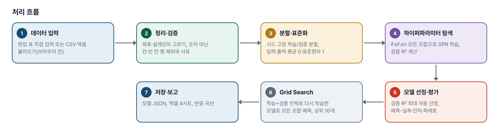
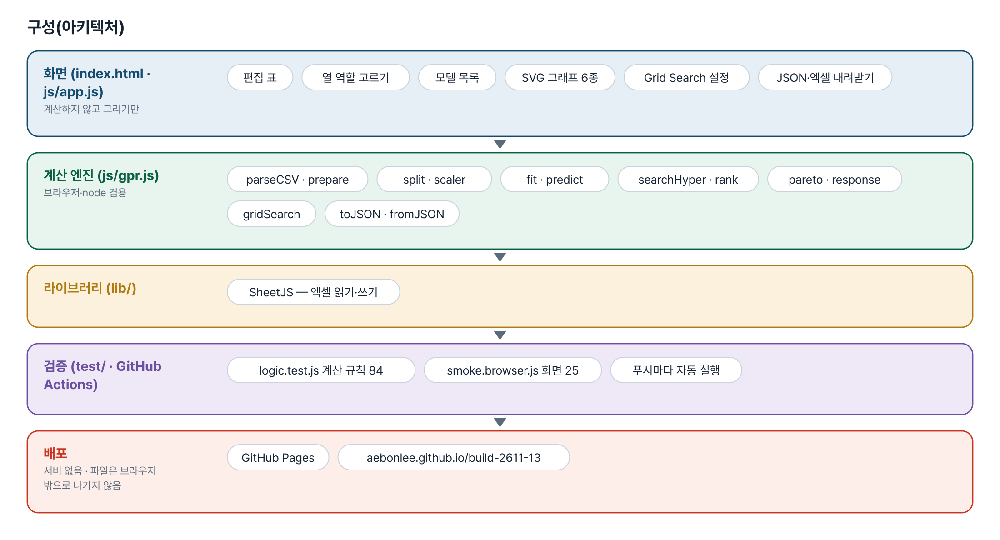
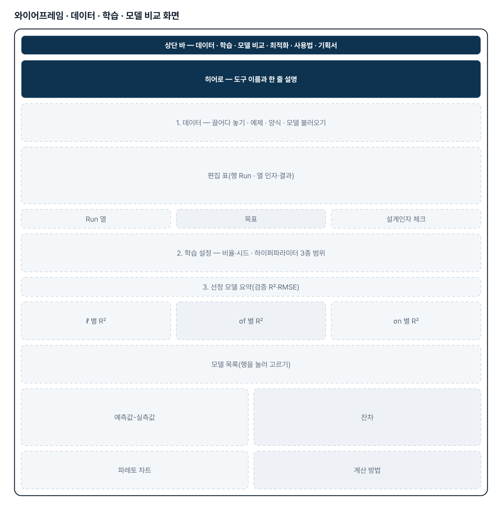
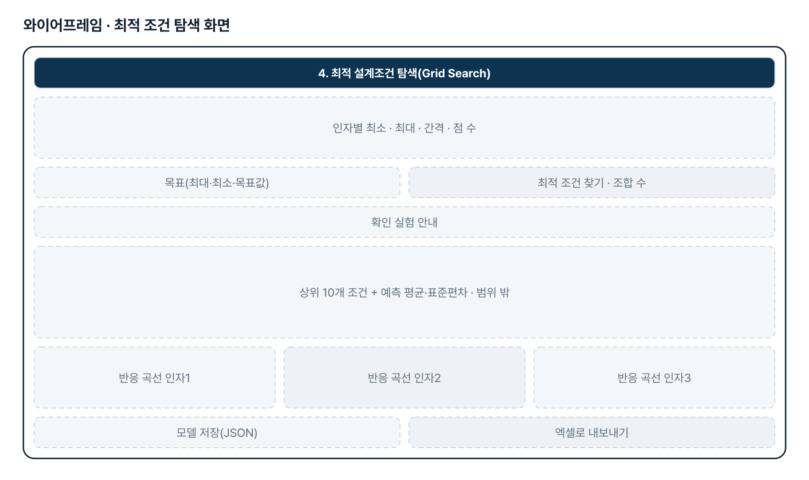
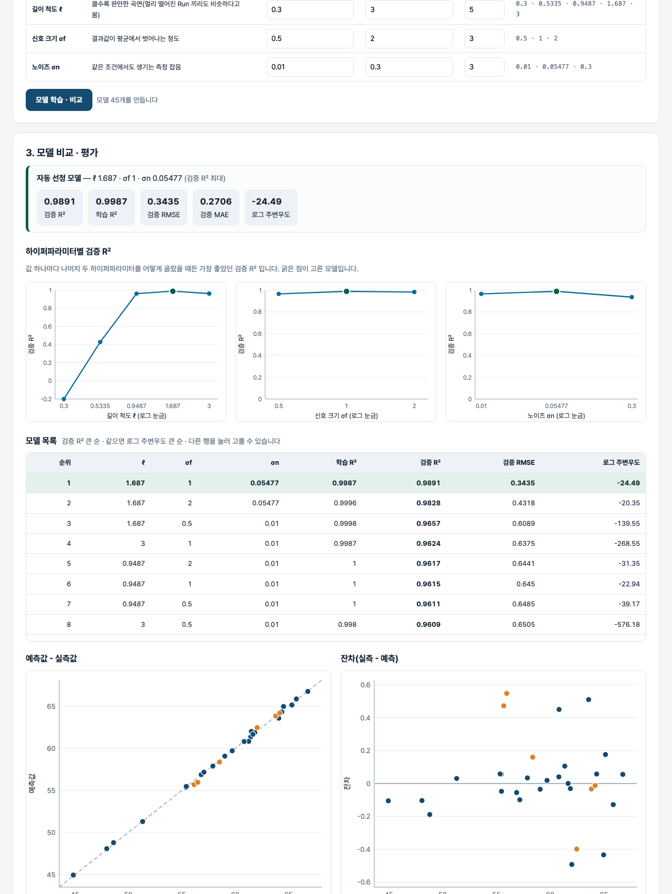

# 머신러닝 기반 최적화 툴 — 프로젝트 기획서 v1.0

- 기획: 원광재 · 작성일 2026-11-03 · 생성형 AI 업무자동화 전문가과정 · 2차수 프로젝트 13
- 바로 쓰기: https://build-2611-13.jobability.co.kr/
- 워드 판: `docs/기획서/build-2611-13_원광재_머신러닝기반최적화툴_기획서_v1.0.docx`

## 개요

실험·해석 데이터로 가우시안 프로세스 회귀(GPR) 모델을 하이퍼파라미터 조합마다 만들어 검증 R²로 비교·선정하고, 고른 모델로 Grid Search 를 돌려 최적 설계조건과 예측 불확실성을 보여 주는 브라우저 도구입니다.

### 배경 · 현재 업무
- 설계인자를 바꿔 가며 실험·해석한 데이터는 쌓이지만, 그 데이터로 예측 모델을 만들고 최적 조건을 찾는 과정은 사람마다 도구가 다릅니다.
- GPR 은 데이터가 수십~수백 Run 일 때도 예측과 불확실성을 함께 주지만, 하이퍼파라미터에 따라 성능이 크게 달라집니다.
- 학습/검증 비율·하이퍼파라미터 범위를 바꿔 모델을 비교하고, 고른 모델로 전역 탐색까지 한 화면에서 하는 범용 도구가 필요합니다.

### 목표
- 설계인자·결과 데이터를 직접 입력하거나 CSV·엑셀로 불러와 바로 학습합니다.
- 하이퍼파라미터 3종의 모든 조합으로 모델을 만들어 R²·예측-실측·잔차로 비교하고 최적 모델을 고릅니다.
- 고른 모델로 Grid Search 를 돌려 최적 설계조건과 예측 평균·표준편차를 보여 줍니다.
- 모델은 JSON 으로 저장·불러오고, 결과는 엑셀로 내보냅니다.

## 요구사항과 구현

| 기획서 요구 | 구현 |
|---|---|
| 설계인자·결과 직접 입력, 데이터 테이블(행 Run · 열 인자·결과) | 편집 표(행·열 추가, 엑셀 붙여넣기) + Run 열·목표·설계인자 고르기 |
| CSV 파일 불러오기 | CSV(UTF-8·CP949)·엑셀 첫 시트, 숫자 아닌 칸·빈 칸 행은 사유와 함께 제외 |
| 학습/검증 비율 조절 | 비율 50~95% + 시드 — 같은 시드면 같은 분할 |
| 하이퍼파라미터 3종 탐색 범위 | 길이 척도·신호 크기·노이즈 각각 최소·최대·개수(로그 간격) → 모든 조합 학습 |
| 모델별 R² · 최적 모델 선정 | 모델 목록, 검증 R² 최대 자동 선정(동률이면 로그 주변우도), 다른 행 직접 선택 |
| 예측값-실측값 · 잔차 · 파레토 · 성능 비교 그래프 | 산점도(학습/검증 + y=x) · 잔차 · 설계인자 영향도 파레토 · 하이퍼파라미터별 R² |
| Grid Search 최적 설계조건 · 예측 결과 그래프 | 인자별 최소·최대·간격, 조합 수 먼저 표시, 상위 10개 + 예측 평균·표준편차, 반응 곡선(±1σ) |
| 학습 모델 저장·불러오기 | JSON(표준화 계수·하이퍼파라미터·학습 데이터) — 불러오면 같은 예측 |

## 주요 기능

- **데이터 입력** — 편집 표에 직접 적거나 CSV·엑셀을 불러옵니다. 숫자 아닌 칸·빈 칸이 있는 행은 빼고 몇 행의 어느 열 때문인지 보여 줍니다.
- **학습 설정** — 학습 비율·시드와 하이퍼파라미터 3종의 최소·최대·개수를 정하면 조합 수를 먼저 보여 줍니다.
- **모델 비교·선정** — 모든 조합의 학습·검증 R², RMSE, 로그 주변우도를 표로 보여 주고 검증 R² 최대 모델을 자동으로 고릅니다. 행을 눌러 바꿀 수 있습니다.
- **평가 그래프** — 예측값-실측값, 잔차, 하이퍼파라미터별 최고 검증 R², 설계인자 영향도 파레토를 SVG 로 그립니다.
- **Grid Search** — 인자별 범위·간격으로 모든 조합을 예측해 최대·최소·목표값 기준 상위 10개 조건과 표준편차, 학습 범위 밖 여부를 보여 줍니다.
- **저장·내보내기** — 모델 JSON 저장·불러오기, 엑셀(데이터·모델비교·검증예측·최적조건) 내보내기.

## 처리 흐름(파이프라인)

1. **데이터 입력** — 편집 표 직접 입력 또는 CSV·엑셀 불러오기(브라우저 안)
2. **정리·검증** — 목표·설계인자 고르기, 숫자 아닌 칸·빈 칸 행 제외와 사유
3. **분할·표준화** — 시드 고정 학습/검증 분할, 입력·출력 평균 0·표준편차 1
4. **하이퍼파라미터 탐색** — ℓ·σf·σn 모든 조합으로 GPR 학습, 검증 R² 계산
5. **모델 선정·평가** — 검증 R² 최대 자동 선정, 예측-실측·잔차·파레토
6. **Grid Search** — 학습+검증 전체로 다시 학습한 모델로 모든 조합 예측, 상위 10개
7. **저장·보고** — 모델 JSON, 엑셀 4시트, 반응 곡선

## 구성(아키텍처)

- **화면 (index.html · js/app.js)** — 편집 표 · 열 역할 고르기 · 모델 목록 · SVG 그래프 6종 · Grid Search 설정 · JSON·엑셀 내려받기
- **계산 엔진 (js/gpr.js)** — parseCSV · prepare · split · scaler · fit · predict · searchHyper · rank · pareto · response · gridSearch · toJSON · fromJSON
- **라이브러리 (lib/)** — SheetJS — 엑셀 읽기·쓰기
- **검증 (test/ · GitHub Actions)** — logic.test.js 계산 규칙 84 · smoke.browser.js 화면 25 · 푸시마다 자동 실행
- **배포** — GitHub Pages · aebonlee.github.io/build-2611-13

## 화면 구성(와이어프레임)

## 규칙 · 판정 기준

- 입력·출력을 평균 0·표준편차 1 로 표준화한 뒤 학습합니다. 하이퍼파라미터는 이 표준화 단위입니다.
- 커널 k = σf²·exp(−|x−x'|²/(2ℓ²)) + σn²·I. 촐레스키 분해가 실패하면 대각에 작은 값을 더해 다시 합니다.
- R² = 1 − SS잔차/SS전체. 선정은 검증 R² 최대, 동률이면 로그 주변우도가 큰 모델입니다.
- 같은 시드면 같은 학습/검증 분할입니다. 학습 2개 이상 · 검증 1개 이상을 보장합니다.
- 영향도는 다른 인자를 데이터 평균에 고정하고 한 인자만 범위 안에서 바꿀 때 예측이 움직이는 폭입니다.
- Grid Search 조합이 20만 개를 넘으면 계산하지 않고 간격을 넓히도록 안내합니다. 학습 데이터 범위 밖 조건은 표시합니다.

## 검증

- 계산 규칙 테스트 84개 · 화면 연기 테스트 25개 통과
- 테스트를 일부러 깨뜨려 확인했습니다 — 커널 식·지터·분할 시드·동률 규칙을 바꾸면 각각 해당 테스트가 실패합니다. 처음엔 커널 식을 바꿔도 통과해서 커널 값 테스트를 더했습니다.
- 예제(참 최대점 온도 210·압력 6.5·시간 60)에서 Grid Search 1순위가 참 최대 근처인지 테스트로 고정했습니다.
- 화면 테스트: 예제(바로 학습) → 그래프 → 최적 조건 → 모델 저장 → 새 화면에서 불러와 같은 1순위 → 틀린 CSV 행 제외 → 360px.

## 이번 판에서 하지 않는 것

- 브라우저 안 계산이라 수백 행 규모에 맞춰 두었습니다(수천 행 이상은 느려집니다).
- 하이퍼파라미터는 정해진 범위의 격자 탐색만 합니다(인자별 길이 척도·경사 기반 최적화 없음).
- 범주형(글자) 설계인자와 결과값 여러 개 동시 최적화는 하지 않습니다.
- 예측값은 모델 추정이며 확인 실험이 필요합니다.

## 다음 단계

- 인자별 길이 척도(ARD)와 로그우도 기반 자동 하이퍼파라미터 최적화
- 교차검증(k-fold)으로 분할 운에 덜 흔들리는 모델 선정
- 다음 실험점 추천(베이지안 최적화)
- 결과 해석 문장 초안(선택 AI)

## 버전 이력

- **v1.0** (2026-11-03) — 첫 판 — 데이터 입력·GPR 하이퍼파라미터 비교·평가 그래프·Grid Search·모델 저장·엑셀 내보내기 / 기획서 워드 판·파이프라인·아키텍처·와이어프레임 추가
